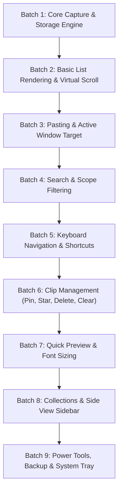

# DualClip Phased Stabilization, Feature Isolation & Testing Plan

> **Purpose**: A rigorous, dependency-ordered roadmap to isolate the core clipboard functionality, turn off non-essential features, test systematically via automated suites (backend + frontend), log and fix edge cases, and re-enable features batch by batch after human verification.

---

## 🎯 High-Level Strategy

1. **Clean Feature Gating**: Non-essential features are safely deactivated so only the target batch scope is active.
2. **Automated Verification First**: For each batch, run targeted backend (`dotnet test`) and frontend tests.
3. **Bug Logging & Fixing**: Any bugs or edge cases encountered are recorded in `docs/STATE.md` with repro steps and root cause before being fixed.
4. **Human Verification Gate**: After automated tests pass, the user conducts manual verification before we enable the next batch.

---

## 📦 Detailed Phased Batches

---

### Batch 1: Core Capture & Storage Engine (Current Focus)
* **What is TURNED ON**:
  - Windows clipboard listener hook (`ClipboardListener.cs`)
  - SQLite storage, deduplication, FIFO maximum clip retention (`DatabaseService.cs`)
  - Basic clip retrieval RPC (`get_clips`)
* **What is TURNED OFF**:
  - All UI overlays, modals, preview lightbox, side view, transformers, backup/export, tray menus.
* **Automated Tests**:
  - `DeduplicationTests.cs`
  - `MaxClipsEnforcementTests.cs`
  - `RichTextCaptureTests.cs`
  - `SvgVectorCaptureTests.cs`
  - `GifCaptureTests.cs`

---

### Batch 2: Basic List Rendering & Virtual Scroll
* **What is TURNED ON**:
  - Basic clip list UI DOM structure (`render.js`)
  - Virtual scroll pool recycling for smooth performance with large history
  - Basic text item truncation & metadata display
* **What is TURNED OFF**:
  - Star/pin icons, delete buttons, drag-drop, tag chips, preview modal.
* **Automated Tests**:
  - `DualClip.Tests/js-harness/pagination-invariants.js`
  - List container height and virtual slice indexing checks.

---

### Batch 3: Paste Execution & Active Window Focus
* **What is TURNED ON**:
  - Click-to-paste clip into target application (`paste_clip` RPC)
  - Focus restoration & input simulation (`AttachThreadInput`, `SendInput`)
  - Auto-hide on paste
* **What is TURNED OFF**:
  - Preview, collections, quick number shortcuts, transformers.
* **Automated Tests**:
  - Paste token sequencing tests
  - RpcContractInvariantTests for `paste_clip`

---

### Batch 4: Instant Search & Filter Logic
* **What is TURNED ON**:
  - Search bar input debounce & query tokenization
  - SQLite FTS5 instant search (`DatabaseService.Search.cs`)
  - Text vs Image tab filtering
* **What is TURNED OFF**:
  - Tag filtering, folder collection filtering, auto-sort rules.
* **Automated Tests**:
  - `SearchTokenizationTests.cs`
  - `SearchScopeTests.cs`
  - `CompactAndSearchInteractionTests.cs`

---

### Batch 5: Keyboard Navigation & Window Shortcuts
* **What is TURNED ON**:
  - Keyboard map routing (`↑`, `↓`, `Enter`, `Esc`, `Tab`)
  - Global summon hotkey (`HotkeyService.cs`)
  - Window sizing presets (Compact vs Standard) & zero-flicker summon
* **What is TURNED OFF**:
  - Complex modal hotkeys, preview shortcuts, multi-select shortcuts.
* **Automated Tests**:
  - `WindowSizePolicyTests.cs`
  - `WindowPlacementTests.cs`
  - `ModeSwitchInvariantTests.cs`

---

### Batch 6: Clip Management & Life-Cycle
* **What is TURNED ON**:
  - Star/Favorite toggle (`toggle_favorite`)
  - Pin/Unpin to top (`toggle_pin`)
  - Delete individual clip (`delete_clip`)
  - Clear history modal (`clear_history`)
* **What is TURNED OFF**:
  - Folders, tags, drag-and-drop, backup export.
* **Automated Tests**:
  - `ClearHistoryScopeTests.cs`
  - `ClipRenameTests.cs`
  - `AutoTierInvariantTests.cs`

---

### Batch 7: Quick Preview Modal & Text Zoom
* **What is TURNED ON**:
  - Full preview overlay (`#previewModal`)
  - Format detection (Code, JSON, Markdown, URL, Plain Text)
  - Live font zoom (`Ctrl+Wheel`, `Ctrl +/-/0`) & font family toggle
  - Quick clip text editor
* **What is TURNED OFF**:
  - Sidebar folders, transformers, cloud backup.
* **Automated Tests**:
  - `FormatDetectionInvariantTests.cs`
  - `DualClip.Tests/js-harness/format-detection-invariants.js`

---

### Batch 8: Collections, Folders & Side View Layout
* **What is TURNED ON**:
  - Side View sidebar toggle (`sidebar-layout.js`)
  - Nested folders & drag-and-drop reorganization
  - Tag chips & folder badge counts
* **What is TURNED OFF**:
  - Power tools, tray menu actions.
* **Automated Tests**:
  - `SidebarLayoutTests.cs`
  - `SidebarNestedAdversarialTests.cs`
  - `AddTextToCollectionTests.cs`
  - `TagAndNicknameQueryTests.cs`

---

### Batch 9: Power Tools, Backup & System Tray
* **What is TURNED ON**:
  - Text transformers (Case change, JSON minify, Slugify)
  - Archive backup import/export (`.dualclip` / `.zip`)
  - Tray pause menu & timed capture suspension
  - Global settings persistence
* **Automated Tests**:
  - `ExportImportOrderingTests.cs`
  - `PackageValidationTests.cs`
  - `ClearOnLockTests.cs`
  - Full test suite run.

---

## 🛠️ Verification & Quality Gates

1. **Build Quality**: `taskkill /F /IM DualClip.exe 2>$null; dotnet build DualClip.csproj -c Release -warnaserror` (0 errors, 0 warnings).
2. **JS Syntax Quality**: `node --check ui/js/**/*.js`.
3. **Automated Test Suite**: Targeted test execution per batch.
4. **Human Verification**: Manual check by the user before unlocking the next batch.
